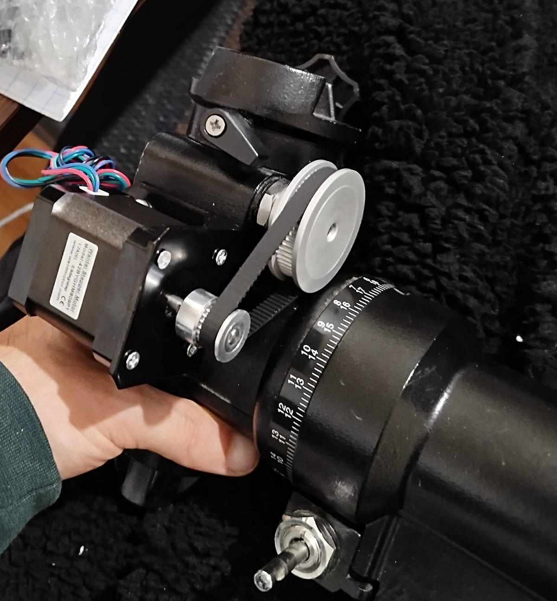
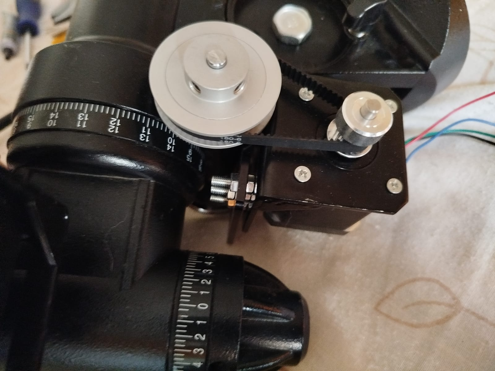
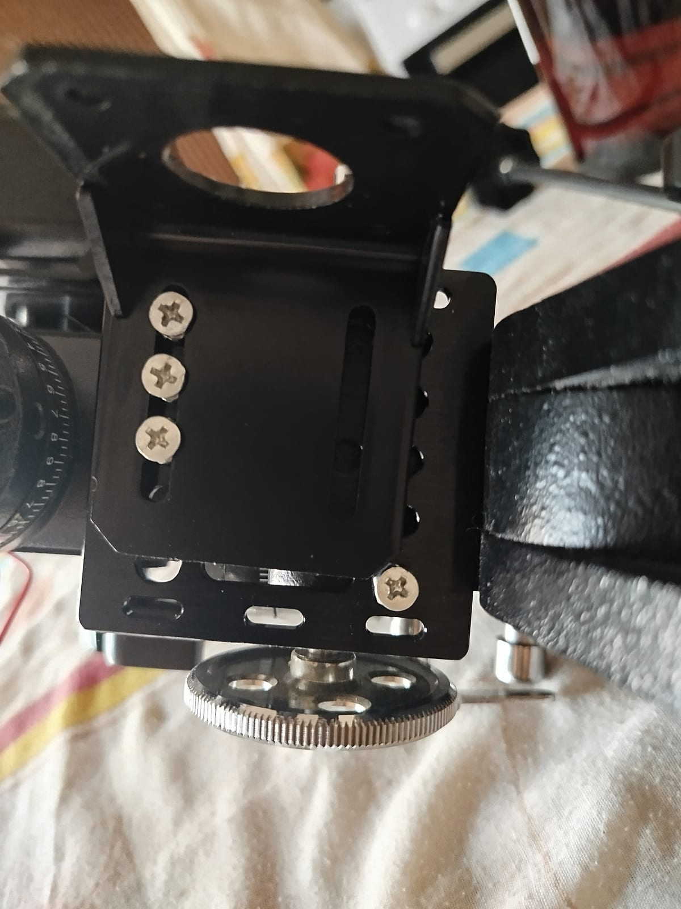
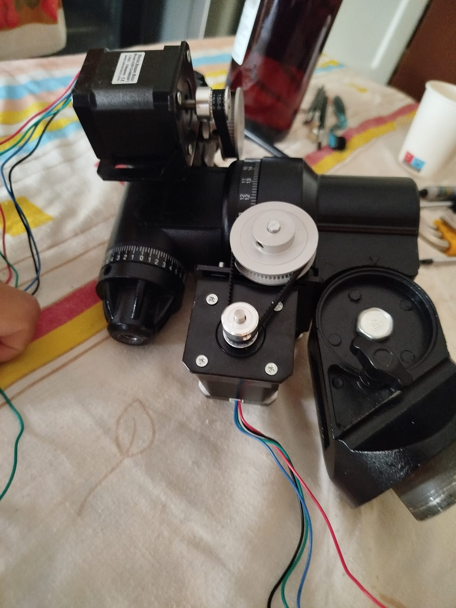
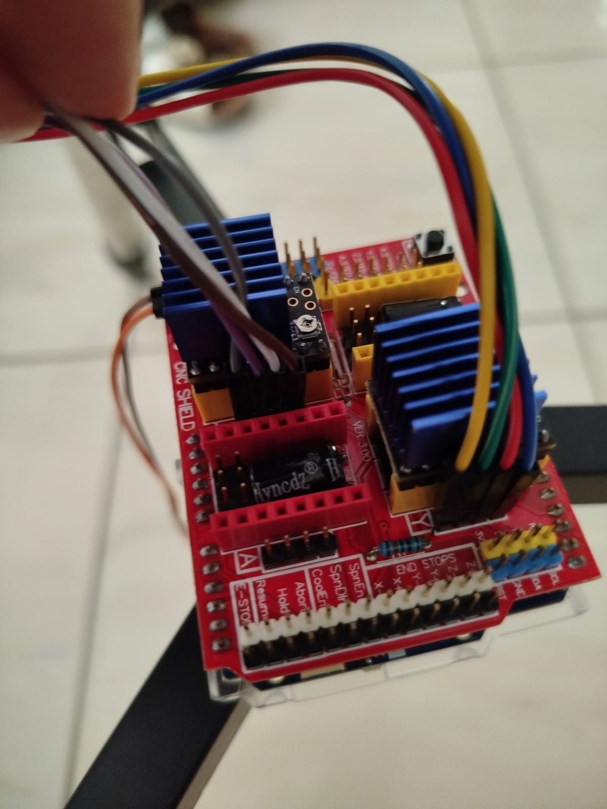
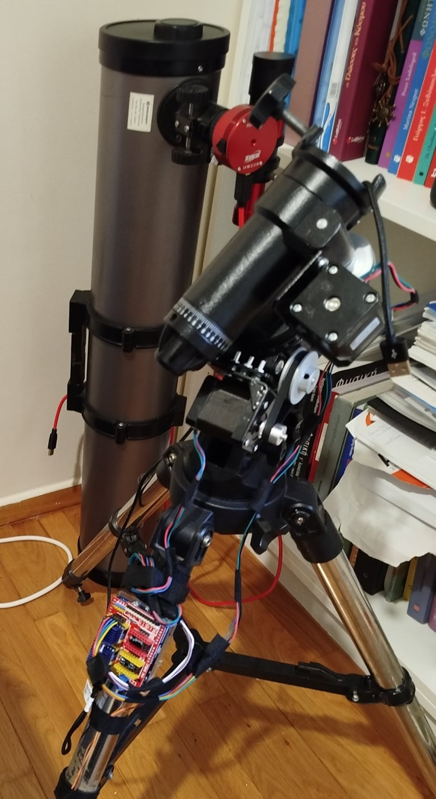

Το πρώτο μου τηλεσκόπιο, όπως και πολλών ερασιτεχνών αστρονόμων, ήταν ένα νευτώνειο σε μια οικονομική ισημερινή στήριξη: τη **[Bresser EQ-3](https://www.bresser.com/p/bresser-eq-3-telescope-mount-incl.-tripod-black-4964450)**. Με εξυπηρέτησε μια χαρά στην οπτική παρατήρηση. Μετά θέλησα να δοκιμάσω αστροφωτογραφία, και γι’ αυτήν χρειάζεσαι στήριξη που ακολουθεί τον ουρανό και στρέφεται μόνη της σε έναν στόχο: μια στήριξη **GoTo**.

Μια καινούρια στήριξη GoTo ήταν πάνω από τις δυνατότητές μου. Κιτ αναβάθμισης υπάρχουν για στηρίξεις Sky-Watcher (για παράδειγμα τα [κιτ OnStep](https://www.terransindustry.com/collections/onstep-v4-kit)), αλλά για την EQ-3 δεν βρήκα κανένα. Η Bresser πουλάει ένα [μοτέρ για τον άξονα RA](https://www.bresser.com/p/bresser-ra-tracking-motor-controller-4951400), αλλά αυτό κάνει μόνο παρακολούθηση και είναι ακριβό για ό,τι προσφέρει.

Έτσι, για χρόνια περίμενα και γκρίνιαζα. Ώσπου μου ήρθε η ιδέα: αντί να περιμένω, γιατί να μην αναβαθμίσω τη στήριξη μόνος μου; Αυτή η σειρά άρθρων λέει πώς πήγε. Σε αυτό το πρώτο μέρος βάζω μοτέρ και στους δύο άξονες και τα γυρίζω από υπολογιστή. Το [μέρος 2](../eq3-goto-part-2/) καλύπτει το firmware που την κάνει πραγματική στήριξη GoTo.

## 1. Τα μηχανικά του πρώτου άξονα (απόκλιση)

Αντέγραψα την ιδέα από το κιτ OnStep: σε κάθε άξονα, ένα **βηματικό μοτέρ** κινεί τον άξονα λεπτής κίνησης της στήριξης μέσω ενός **οδοντωτού ιμάντα**.

- **Μοτέρ:** ένα NEMA 17, σαν αυτό που χρησιμοποιεί το OnStep. Διάλεξα μοντέλο **0,9°/βήμα** (400 βήματα ανά στροφή) αντί για το συνηθισμένο 1,8°, γιατί διπλασιάζει την ανάλυση. Κόστισε €16,90.
- **Βάση μοτέρ:** μια τυπική βάση NEMA 17 που κρατά το μοτέρ πάνω στη στήριξη.
- **Τροχαλίες:** GT2, **20 δόντια** στον άξονα του μοτέρ (5 mm) και **60 δόντια** στον άξονα της στήριξης (6 mm). Αυτό δίνει **υποβιβασμό 3:1**, άρα περισσότερη ροπή και τριπλάσια ανάλυση ακόμα.
- **Ιμάντας:** δεν είχα ιδέα τι μήκος χρειαζόταν, οπότε διάλεξα ένα λίγο-πολύ στην τύχη: **188 mm**.

Όλα έφτασαν και, σχεδόν ως διά μαγείας, ταίριαξαν. Το μόνο που έλειπε ήταν βίδες για να στερεώσω το μοτέρ στη βάση του και τη βάση στη στήριξη. Ένα σετ βίδες M3/M4 το έλυσε, και είχα πια βηματικό μοτέρ στον άξονα της απόκλισης.

*Πρώτη τοποθέτηση, Δεκέμβριος 2025: η τροχαλία 20 δοντιών στο μοτέρ, η τροχαλία 60 δοντιών στον άξονα και ο ιμάντας 188 mm ανάμεσά τους.*

| Εξάρτημα (απόκλιση) | Τιμή |
|---|---|
| [Βηματικό NEMA 17, 0,9° (42BYGHM809)](https://grobotronics.com/42byghm809-4.8kg.cm-400-steps-rev.html) | €16,90 |
| [Βάση μοτέρ NEMA 17](https://grobotronics.com/stepper-motor-mount-nema-17.html) | €1,90 |
| [Τροχαλία GT2, 20 δόντια, οπή 5 mm](https://grobotronics.com/aluminum-gt2-timing-pulley-20-tooth.html) | €1,60 |
| [Τροχαλία GT2, 60 δόντια, οπή 6 mm](https://grobotronics.com/aluminum-gt2-timing-pulley-60t.html) | €3,60 |
| [Ιμάντας GT2, 188 mm](https://grobotronics.com/timing-belt-gt2-188mm.html) | €1,40 |
| **Σύνολο** (συν μερικές βίδες) | **€25,40** |

Σχεδόν όλα τα εξαρτήματα τα αγόρασα από το [Grobotronics](https://grobotronics.com/), ένα κατάστημα ηλεκτρονικών στην Ελλάδα. Οι σύνδεσμοι στους πίνακες οδηγούν στις σελίδες των προϊόντων τους (οι οδηγοί TMC2209 οδηγούν σε σελίδα σύγκρισης τιμών στο Skroutz). Κανένας δεν είναι σύνδεσμος affiliate.

## 2. Πρώτα ηλεκτρονικά: να κουνηθεί το μοτέρ

Ένα βηματικό μοτέρ χρειάζεται έναν **οδηγό** (driver) ανάμεσα σε αυτό και σε ό,τι στέλνει τις εντολές. Η έρευνά μου έδειχνε τον **TMC2209** ως την καλύτερη επιλογή (αθόρυβος και ομαλός), αλλά δεν τον έβρισκα διαθέσιμο στην Ελλάδα. Πήρα λοιπόν ό,τι υπήρχε: έναν **A4988** και έναν **DRV8825**. Μαζί τους παρήγγειλα ένα breadboard, ένα πολύμετρο, έναν πυκνωτή και ένα τροφοδοτικό 24 V με βύσμα barrel.

Ακολούθησα βήμα βήμα αυτό το βίντεο: [Control a NEMA 17 stepper motor with an A4988 driver and Arduino](https://www.youtube.com/watch?v=wcLeXXATCR4). Η μόνη διαφορά ήταν ότι χρησιμοποίησα ένα **Raspberry Pi** που είχα στο συρτάρι αντί για Arduino. Σε αυτό το στάδιο ήθελα μόνο να ελέγξω ότι όλα τα κομμάτια δουλεύουν. Ένα Raspberry Pi είναι υπερβολή για να οδηγεί δύο μοτέρ, και αργότερα το αντικατέστησα με μικροελεγκτή.

Δούλεψε: ο άξονας της απόκλισης κινούνταν με εντολή.

<figure class="compact">
  <video controls muted playsinline preload="none" width="480" height="480" poster="/media/eq3-goto/first-axis-test-poster.jpg" src="/media/eq3-goto/first-axis-test.mp4"></video>
  <figcaption>Πρώτη περιστροφή: το NEMA 17 γυρίζει τον άξονα της απόκλισης και πίσω του φαίνεται η δοκιμαστική διάταξη: ένας οδηγός βηματικού μοτέρ σε breadboard, ελεγχόμενος από ένα Raspberry Pi.</figcaption>
</figure>

## 3. Τα μηχανικά του δεύτερου άξονα (ορθή αναφορά)

Ο άξονας της ορθής αναφοράς (RA) ήταν καθρέφτης του πρώτου, με δύο διαφορές:

- Από αυτή την πλευρά η βάση του μοτέρ δεν μπορούσε να ακουμπήσει απευθείας στη στήριξη, οπότε πρόσθεσα μια **πλάκα V-slot gantry** ως προέκταση και στερέωσα τη βάση πάνω της.
- Αυτή τη φορά παρήγγειλα **διάφορα μήκη ιμάντα** (160, 188 και 202 mm) για να αυξήσω τις πιθανότητές μου.

Όλα ταίριαξαν εκτός, φυσικά, από τον ιμάντα. Κανένας από τους τρεις δεν ήταν σωστός. Στην επόμενη παραγγελία πήρα ιμάντα **180 mm**. Ούτε αυτός ταίριαζε τέλεια, οπότε έβαλα παρέμβυσμα ανάμεσα στη βάση του μοτέρ και την πλάκα για να τον τεντώσω. Δούλεψε.

*Η κίνηση του RA με τον ιμάντα των 180 mm.*

*Η βάση του μοτέρ πάνω στην πλάκα V-slot gantry. Οι επιμήκεις οπές αφήνουν περιθώριο για να ρυθμίσεις τη θέση του μοτέρ.*

*Και οι δύο άξονες με μοτέρ.*

| Εξάρτημα (ορθή αναφορά) | Τιμή |
|---|---|
| [Βηματικό NEMA 17, 0,9° (42BYGHM809)](https://grobotronics.com/42byghm809-4.8kg.cm-400-steps-rev.html) | €16,90 |
| [Βάση μοτέρ NEMA 17](https://grobotronics.com/stepper-motor-mount-nema-17.html) | €1,90 |
| Τροχαλίες GT2, [20](https://grobotronics.com/aluminum-gt2-timing-pulley-20-tooth.html) + [60](https://grobotronics.com/aluminum-gt2-timing-pulley-60t.html) δόντια | €5,20 |
| [Πλάκα V-slot gantry 20 mm](https://grobotronics.com/v-slot-gantry-plate-20mmoem.html) | €3,60 |
| [Ιμάντας GT2, 180 mm](https://grobotronics.com/timing-belt-gt2-180mm.html) | €1,40 |
| Βίδες και παξιμάδια | €0,48 |
| **Σύνολο** | **€29,48** |

## 4. Τα ηλεκτρονικά, δεύτερη προσπάθεια (και τι πήγε στραβά)

Με μοτέρ και στους δύο άξονες, χρειαζόμουν έναν κανονικό ελεγκτή. Πρώτα διάλεξα ένα **ESP32-S3 DevKitC-1**: έχει Wi-Fi και προγραμματίζεται εύκολα μέσω USB. Το σύνδεσα με τους οδηγούς πάνω στο breadboard.

Εκεί έμαθα τρία μαθήματα με τον δύσκολο τρόπο:

1. **Ένα breadboard δεν αντέχει το ρεύμα βηματικών μοτέρ.** Οι επαφές του είναι φτιαγμένες για σήματα, όχι για αμπέρ που πηγαίνουν σε δύο μοτέρ.
2. **Ο πυκνωτής μου δεν ήταν κατάλληλος.** Ένας οδηγός χρειάζεται τον σωστό πυκνωτή ακριβώς στην είσοδο τροφοδοσίας του, για να απορροφά τις αιχμές τάσης από το μοτέρ.
3. **Το τροφοδοτικό μου ήταν πολύ αδύναμο.** 24 V στα 2 A δεν φτάνουν για δύο μοτέρ που κινούνται ταυτόχρονα.

Η λύση αποδείχτηκε μία φτηνή πλακέτα: το **Arduino CNC Shield V3**, για €3,60. Είναι φτιαγμένο για να οδηγεί βηματικά μοτέρ (χρησιμοποιείται σε 3D εκτυπωτές και CNC). Έχει υποδοχές για έως τέσσερις οδηγούς, σωστή καλωδίωση τροφοδοσίας, και κουμπώνει κατευθείαν πάνω σε ένα Arduino. Έτσι πέρασα από το ESP32 σε ένα **Arduino UNO R4 WiFi** (€32,80), και σε τροφοδοτικό **12 V 5 A** (€9,90).

Και για τους οδηγούς, γύρισα στην πρώτη μου επιλογή: δύο **TMC2209**, έναν για κάθε άξονα. Αυτή τη φορά τους βρήκα: €6,90 ο καθένας. Είναι πολύ πιο αθόρυβοι από τους A4988 και DRV8825 και κινούν τα μοτέρ πιο ομαλά, κάτι που μετράει όταν η στήριξη πρέπει να ακολουθεί τον ουρανό αργά και σταθερά. Οι δικοί μου είναι η έκδοση UART, που ρυθμίζεται μέσω σειριακής σύνδεσης, αλλά προς το παρόν τους χρησιμοποιώ σε απλή λειτουργία step/direction, όπως και τους άλλους οδηγούς.

*Τα τελικά ηλεκτρονικά: το CNC Shield V3 πάνω στο Arduino, με δύο οδηγούς TMC2209 κάτω από μπλε ψύκτρες.*

### Η συνδεσμολογία

Με το CNC Shield η συνδεσμολογία είναι σχεδόν «βάζεις και δουλεύει»:

1. **Το shield πάνω στο Arduino.** Κουμπώνει κατευθείαν στις ακίδες του UNO.
2. **Πρώτα τα jumper των μικροβημάτων.** Κάτω από κάθε υποδοχή οδηγού υπάρχουν τρία ζεύγη ακίδων. Κάθε [jumper](https://grobotronics.com/jumper-2-54mm-2-pin-blue.html) (ένα μικρό καπάκι 2,54 mm) συνδέει μια ακίδα ρύθμισης του οδηγού (MS1, MS2) στα 5 V, και ο συνδυασμός επιλέγει τα μικροβήματα. Εγώ δουλεύω με 16· τον πίνακα τον δίνει το [datasheet του TMC2209](https://www.analog.com/en/products/tmc2209.html).
3. **Οι οδηγοί στις υποδοχές τους**, ένας για κάθε άξονα. Με το OnStep η ορθή αναφορά μπαίνει στο X και η απόκλιση στο Y (το δικό μου firmware χρησιμοποιούσε το Z για την ορθή αναφορά). Ευθυγράμμισε την ακίδα EN του οδηγού με την ένδειξη EN πάνω στο shield: ένας οδηγός τοποθετημένος ανάποδα καίγεται.
4. **Τα μοτέρ στις τετράπινες υποδοχές** δίπλα σε κάθε οδηγό. Αν ένας άξονας γυρίζει ανάποδα, γύρνα τον συνδετήρα ή αντέστρεψε τη φορά από το λογισμικό.
5. **Η τροφοδοσία στη μπλε κλέμα:** 12 V από το τροφοδοτικό των 5 A, προσέχοντας το + και το −. Αυτή τροφοδοτεί μόνο τα μοτέρ· το ίδιο το Arduino τροφοδοτείται από το USB.
6. **Ρύθμισε το ρεύμα των μοτέρ** με το μικρό ποτενσιόμετρο κάθε οδηγού πριν από την πρώτη χρήση, ώστε τα μοτέρ να μένουν δροσερά χωρίς να χάνουν βήματα.

Ένας κανόνας πάνω από όλα: ποτέ μη συνδέεις ή αποσυνδέεις μοτέρ όσο η τροφοδοσία είναι αναμμένη. Μπορεί να καταστρέψει τον οδηγό.

## 5. Από το μοτέρ στον ουρανό: με πόση ακρίβεια γυρίζουν οι άξονες

Το μοτέρ γυρίζει μια μικρή τροχαλία 20 δοντιών, και ο ιμάντας μεταφέρει την κίνηση σε μια τροχαλία 60 δοντιών στον άξονα λεπτής κίνησης της στήριξης: υποπολλαπλασιασμός 3:1. Ο άξονας αυτός είναι ένας [ατέρμονας κοχλίας](https://en.wikipedia.org/wiki/Worm_drive), μια βίδα που εμπλέκεται με έναν μεγάλο οδοντωτό τροχό στον άξονα της στήριξης. Κάθε πλήρης περιστροφή του ατέρμονα μετακινεί τον τροχό μόλις κατά ένα δόντι, οπότε ο άξονας γυρίζει αργά και με ακρίβεια.

<figure class="compact">
  
  <figcaption>Ένας ατέρμονας κοχλίας γυρίζει έναν οδοντωτό τροχό. Κινούμενη εικόνα: <a href="https://commons.wikimedia.org/wiki/File:Worm_Gear.gif">Wikimedia Commons</a>, κοινό κτήμα.</figcaption>
</figure>

Κάθε υποπολλαπλασιασμός σε αυτή την αλυσίδα κάνει τον άξονα να κινείται σε μικρότερα βήματα. Το μοτέρ έχει 400 πλήρη βήματα ανά στροφή, και ο οδηγός χωρίζει το καθένα σε 16 *μικροβήματα*, όπως ορίζουν τα jumper από τη συνδεσμολογία παραπάνω. Στον άξονα της ορθής αναφοράς, μία πλήρης στροφή θέλει τότε 400 × 16 × 3 (ιμάντας) × 140 (τροχός του ατέρμονα): περίπου 2,7 εκατομμύρια μικροβήματα, ή 7.470 ανά μοίρα. Άρα κάθε μικροβήμα γυρίζει τον άξονα περίπου **μισό δευτερόλεπτο του τόξου**.

<figure class="note-figure" role="img" aria-label="Μια χειρόγραφη σημείωση που υπολογίζει πόσο γυρίζει τον άξονα ένα μικροβήμα: 400 βήματα επί 16 μικροβήματα επί 3 για τον ιμάντα επί 140 για τον τροχό του ατέρμονα κάνουν 2.688.000 μικροβήματα ανά στροφή, άρα περίπου 0,48 δευτερόλεπτα του τόξου το καθένα.">

Πόσο μικρό είναι ένα βήμα;
<svg viewBox="0 0 340 168" aria-hidden="true">
<rect class="pen" x="8" y="44" width="40" height="40" rx="3" />
<path class="pen" d="M48 64 H55" />
<circle class="pen" cx="64" cy="64" r="9" />
<circle class="pen" cx="140" cy="64" r="26" />
<path class="pen" d="M64 55 L140 38 M64 73 L140 90" />
<path class="pen" d="M166 64 H196" />
<rect class="pen" x="196" y="52" width="64" height="24" rx="4" />
<path class="pen" d="M208 52 L200 76 M220 52 L212 76 M232 52 L224 76 M244 52 L236 76 M256 52 L248 76" />
<circle class="pen" cx="228" cy="118" r="40" />
<circle class="pen-red" cx="228" cy="118" r="43" stroke-dasharray="3 4" />
<text class="pen-text" x="6" y="104" style="font-size:16px">μοτέρ</text>
<text class="pen-text" x="50" y="40" style="font-size:16px">20T</text>
<text class="pen-text" x="124" y="28" style="font-size:16px">60T</text>
<text class="pen-text" x="84" y="110" style="font-size:16px">3 : 1</text>
<text class="pen-text" x="196" y="44" style="font-size:16px">ατέρμονας</text>
<text class="pen-text" x="208" y="124" style="font-size:16px">140T</text>
</svg>
400 βήματα
× 16 μικροβήματα
× 3 (ιμάντας)
× 140 (ατέρμονας)
= 2.688.000 ανά στροφή
360° = 1.296.000″
1.296.000″ / 2.688.000
≈ 0,48″
≈ μισό δευτερόλεπτο τόξου ανά βήμα!

</figure>

Γιατί 16 μικροβήματα; Ένας TMC2209 προσφέρει 8, 16, 32 ή 64. Περισσότερα δίνουν ομαλότερη κίνηση, που βολεύει την αργή αστρική παρακολούθηση, αλλά τότε το Arduino πρέπει να στέλνει περισσότερους παλμούς για την ίδια κίνηση, κάτι που περιορίζει πόσο γρήγορα μπορεί να στραφεί η στήριξη. Τα 16 είναι μια καλή ισορροπία, και ο TMC2209 έτσι κι αλλιώς εξομαλύνει εσωτερικά κάθε μικροβήμα σε 256 λεπτότερα.

Για σύγκριση, το επίσημο [κιτ GoTo SynScan της Sky-Watcher για την EQ3](https://eu.levenhuk.com/catalogue/accessories/telescope-accessories/telescope-mounts/sky-watcher-eq3-mount-synscan-upgrade-kit/) δίνεται στα περίπου 0,3″, και η πολύ μεγαλύτερη [EQ6-R Pro](https://www.robtics.nl/en/equatorial-eq/sky-watcher-eq6-r-pro-synscan-heavy-duty-computerised-go-to-mount) στα περίπου 0,14″. Όλα αυτά είναι λεπτότερα από το θάμπωμα της ατμόσφαιρας σε μια συνηθισμένη νύχτα, περίπου 2–4″. Το πραγματικό όριο είναι αλλού: μικρά σφάλματα στα ίδια τα γρανάζια της στήριξης.

Μια επιφύλαξη: τα 140 δόντια του τροχού του ατέρμονα ήταν σε αυτό το σημείο υπόθεσή μου, όχι μετρημένος αριθμός. Στο [μέρος 2](../eq3-goto-part-2/#τα-γρανάζια-γράσο-εμπλοκή-και-περιοδικό-σφάλμα) ξαναλιπαίνω τα γρανάζια και ρυθμίζω την εμπλοκή των ατερμόνων για να μειώσω το περιοδικό τους σφάλμα. Η μέτρηση αυτού του σφάλματος επιβεβαιώνει επίσης τα 140 δόντια: επαναλαμβάνεται μία φορά σε κάθε στροφή του ατέρμονα, περίπου κάθε 10 λεπτά.

## 6. Πόσο κόστισε

| | Κόστος |
|---|---|
| Μηχανικά, άξονας απόκλισης | €25,40 |
| Μηχανικά, άξονας ορθής αναφοράς | €29,48 |
| **Μηχανικά, και οι δύο άξονες** | **≈ €55** |
| [Arduino UNO R4 WiFi](https://grobotronics.com/arduino-uno-r4-wifi.html) | €32,80 |
| [Arduino CNC Shield V3](https://grobotronics.com/arduino-cnc-shield-v3.html) | €3,60 |
| [Οδηγοί TMC2209](https://www.skroutz.gr/s/61336081/47217-tmc2209-v1-2-uart-stepper-motor-driver.html), 2 × €6,90 | €13,80 |
| [Τροφοδοτικό 12 V 5 A](https://grobotronics.com/power-supply-12v-5a-output-5.5x2.1-sn-12d500.html) | €9,90 |
| **Ηλεκτρονικά** | **≈ €60** |
| **Η τελική κατασκευή** | **≈ €115** |
| Όσα ξόδεψα πραγματικά μέχρι εδώ | ≈ €215 |

Η διαφορά ανάμεσα στους δύο τελευταίους αριθμούς είναι το κόστος της μάθησης: ιμάντες που περίσσεψαν, οι A4988 και DRV8825 με τους οποίους δοκίμασα πριν από τους TMC2209, η παράκαμψη με το breadboard και το ESP32, και εργαλεία όπως το πολύμετρο. Αν ακολουθήσεις αυτή την κατασκευή, μπορείς να γλιτώσεις τα περισσότερα.

## Επόμενο: να γίνει στήριξη GoTo

*Όλη η διάταξη: και τα δύο μοτέρ με τους ιμάντες στην κεφαλή της στήριξης, και το CNC Shield με τους οδηγούς του δεμένο σε ένα πόδι του τρίποδα.*

Σε αυτό το σημείο είχα δύο μοτέρ που γύριζαν με εντολή. Μια στήριξη GoTo χρειάζεται επίσης να ξέρει πού κοιτάζει, να ακολουθεί τον ουρανό με τη σωστή ταχύτητα και να μιλά με λογισμικό πλανηταρίου. Αυτό είναι το θέμα του [μέρους 2](../eq3-goto-part-2/): το λογισμικό που κάνει αυτά τα μοτέρ στήριξη GoTo, και οι πρώτες νύχτες κάτω από τον ουρανό. Μια μικρή πρόγευση:

*M27, το νεφέλωμα Αλτήρας (Dumbbell). Περισσότερες εικόνες πρώτου φωτός, και πώς τραβήχτηκαν, στο [μέρος 2](../eq3-goto-part-2/#πρώτο-φως).*
