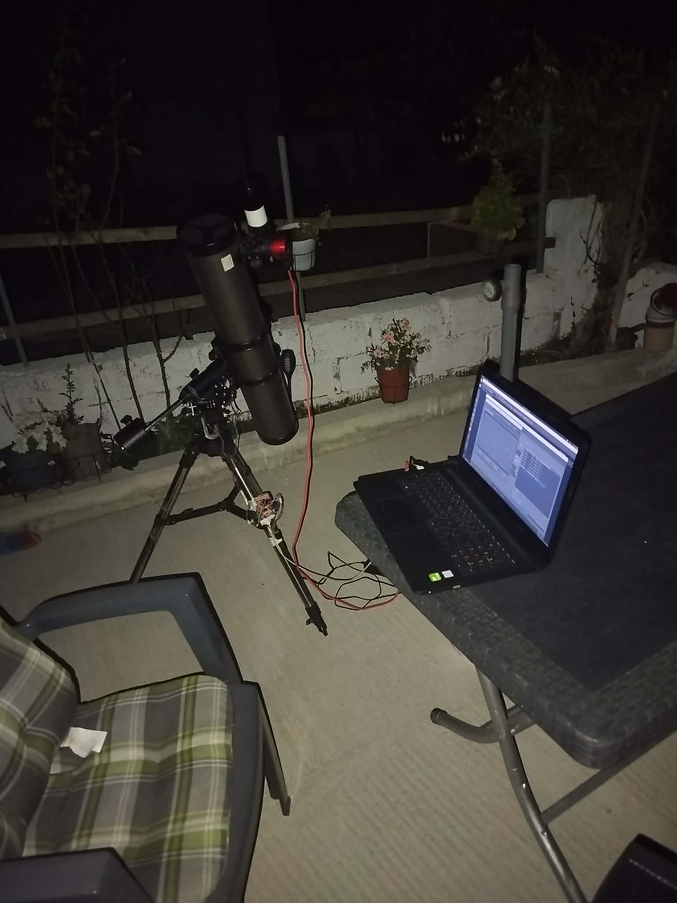
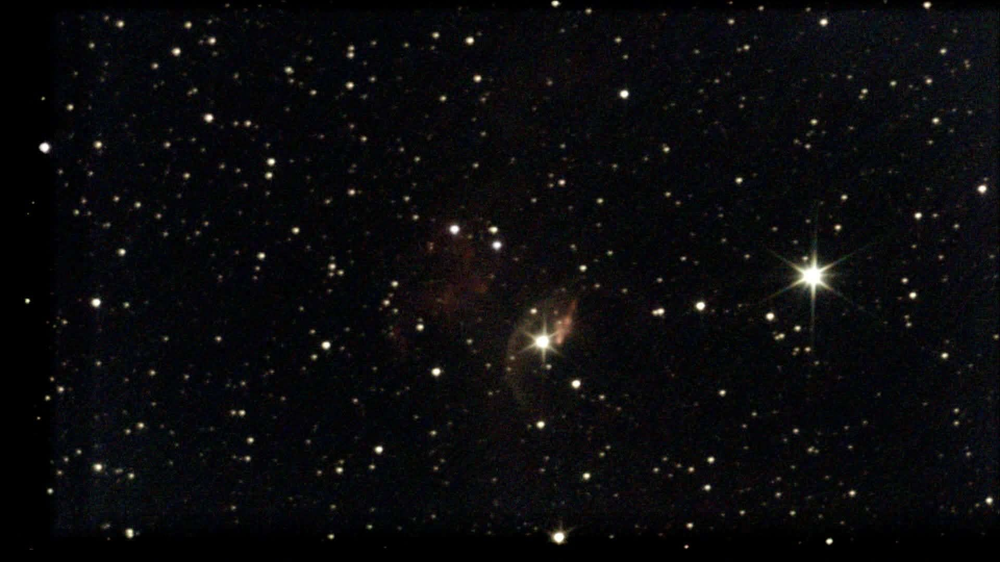
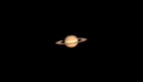

Στο τέλος του [μέρους 1](../eq3-goto-part-1/) είχα μια [Bresser EQ-3](https://www.bresser.com/p/bresser-eq-3-telescope-mount-incl.-tripod-black-4964450) με ένα μοτέρ και έναν ιμάντα σε κάθε άξονα, και δύο μοτέρ που γύριζαν όταν τους το έλεγα. Αυτό δεν είναι ακόμα στήριξη GoTo. Η στήριξη δεν είχε ιδέα πού κοίταζε, και τίποτα δεν της έλεγε πού να πάει.

Αυτό το μέρος είναι ο εγκέφαλος: ένα μικρό πρόγραμμα (firmware) που τρέχει στο Arduino. Με αυτό, κάνω κλικ σε έναν στόχο σε ένα πρόγραμμα πλανηταρίου και το τηλεσκόπιο στρέφεται εκεί, ακολουθεί τον ουρανό και μπορεί να οδηγηθεί. Εδώ περιγράφω τι χρειάστηκε, χωρίς τις λεπτομέρειες του κώδικα. Αν τις θέλεις, ο πλήρης κώδικας είναι στο GitHub: [eq3-goto-firmware](https://github.com/karampitsos/eq3-goto-firmware) (άδεια MIT).

Γιατί όχι το [OnStep](https://github.com/hjd1964/OnStepX), το firmware GoTo ανοιχτού κώδικα από τα κιτ του οποίου εμπνεύστηκα τα μηχανικά στο μέρος 1; Υποστηρίζει το CNC Shield V3, αλλά μόνο με πλακέτα ESP32 (το WeMos D1 R32), όχι με το Arduino UNO R4 WiFi μου. Έτσι, αντί να αλλάξω πλακέτα, έγραψα το δικό μου.

**Ενημέρωση (Οκτώβριος 2026):** Το OnStep τρέχει πλέον στην πλακέτα μου. Πρόσθεσα υποστήριξη για το Arduino UNO R4 WiFi στο OnStep, και το έργο δέχτηκε την αλλαγή ([pull request #132](https://github.com/hjd1964/OnStepX/pull/132)). Το χρησιμοποίησα σε αυτή τη στήριξη κάτω από τον ουρανό, και το GoTo, ο συγχρονισμός και η παρακολούθηση λειτουργούν όλα με το [Ekos](https://kstars-docs.kde.org/en/user_manual/ekos.html).

Αν φτιάχνεις κάτι παρόμοιο, τώρα θα ξεκινούσα με το OnStep και όχι με το δικό μου firmware. Αναπτύσσεται εδώ και χρόνια και το χρησιμοποιούν πολλές ιδιοκατασκευές στηρίξεων. Κάνει ήδη πολλά από όσα είναι στη λίστα «δεν κάνει ακόμα» στο τέλος αυτού του άρθρου, όπως όρια ασφαλείας, θέση στάθμευσης (park) και αναστροφή στον μεσημβρινό. Συνεργάζεται επίσης με τα περισσότερα αστρονομικά προγράμματα, και έχει μια ενεργή κοινότητα για να ρωτήσεις όταν κολλήσεις. Το δικό μου firmware μένει χρήσιμο ως ένα μικρό, ευανάγνωστο παράδειγμα του πώς δουλεύει μια στήριξη GoTo.

Ποια πλακέτα; Αν έχεις ήδη ένα UNO R4 WiFi και ένα CNC Shield V3, όπως εγώ, το OnStep δουλεύει πλέον σε αυτά. Το CNC Shield ταιριάζει επίσης στο [WeMos D1 R32](https://www.skroutz.gr/s/58806029/Ttgo-Esp32-Wifi-Bluetooth-Board-4mb-Flash-Uno-D1-R32-Development-Board.html), μια φτηνή πλακέτα ESP32 με το ίδιο σχήμα με ένα Arduino UNO, που το OnStep υποστηρίζει εδώ και καιρό. Αν αγοράζεις από την αρχή, η πιο απλή έτοιμη επιλογή είναι το [FYSETC E4](https://github.com/FYSETC/FYSETC-E4), μια πλακέτα ESP32 με τέσσερις οδηγούς μοτέρ ήδη πάνω της.

Έγραψα το firmware μαζί με το Claude Code, έναν βοηθό προγραμματισμού με τεχνητή νοημοσύνη, και μετά το δοκίμασα και το ρύθμισα στο πεδίο, κάτω από τον πραγματικό ουρανό.

*Έτοιμη για μια νύχτα φωτογράφισης.*

## Τι πρέπει να κάνει μια στήριξη GoTo

1. **Να ξέρει πού κοιτάζει**, σε συντεταγμένες του ουρανού, όχι σε βήματα μοτέρ.
2. **Να παρακολουθεί**: να γυρίζει ακριβώς με τον ρυθμό που γυρίζει ο ουρανός, ώστε ένα άστρο να μένει ακίνητο στην κάμερα.
3. **Να μιλά με λογισμικό**, ώστε να διαλέγω έναν στόχο στην οθόνη και η στήριξη να πηγαίνει εκεί.

## Πώς δένουν τα κομμάτια

<figure class="chain" role="img" aria-label="Αλυσίδα σήματος: το KStars/Ekos και ο οδηγός INDI LX200 GPS στο laptop στέλνουν εντολές LX200 μέσω USB στο firmware του Arduino πάνω στη στήριξη, που οδηγεί δύο οδηγούς TMC2209 και δύο μοτέρ NEMA 17, τα οποία γυρίζουν τους άξονες RA και Dec μέσω ιμάντων.">

laptop

<b>KStars / Ekos</b>πλανητάριο, plate solving, οδήγηση

«πήγαινε στο M27»

<b>Οδηγός INDI: LX200 GPS</b>το μετατρέπει σε εντολές LX200

καλώδιο USB · 9600 baud · π.χ. <code>:MS#</code>

πάνω στη στήριξη

<b>Arduino UNO R4 WiFi</b>το firmware μου: αστρικός χρόνος, GoTo, παρακολούθηση

παλμοί βήματος + κατεύθυνσης

<b>2 × οδηγοί TMC2209</b>πάνω στο CNC Shield V3

ρεύμα μοτέρ

<b>2 × μοτέρ NEMA 17</b>οι ιμάντες (3:1) γυρίζουν τους άξονες RA και Dec

</figure>

Το laptop κάνει τη δύσκολη αστρονομία: καταλόγους άστρων, τον υπολογισμό του πού κοιτάζει η κάμερα από μια φωτογραφία (plate solving) και την οδήγηση. Το Arduino μόνο απαντά σε απλές ερωτήσεις («πού κοιτάζεις;») και εκτελεί απλές εντολές («πήγαινε εκεί», «κινήσου αργά βόρεια»).

## Προσποιούμενο ένα τηλεσκόπιο Meade

Αντί να εφεύρω δικό μου πρωτόκολλο και να γράψω οδηγό γι’ αυτό, έβαλα το Arduino να συμπεριφέρεται σαν ένα **Meade LX200**, ένα τηλεσκόπιο δεκαετιών με το οποίο σχεδόν κάθε πρόγραμμα αστρονομίας ξέρει ακόμα να μιλά. Στο Ekos διαλέγω τον οδηγό «LX200 GPS», επιλέγω τη θύρα USB του Arduino, και συνδέεται σαν να υπήρχε ένα πραγματικό Meade στην άλλη άκρη.

Αυτή η μία απόφαση μού έδωσε GoTo, συγχρονισμό, χειροκίνητες κινήσεις και οδήγηση, χωρίς να γράψω κάτι ειδικό για κανένα από αυτά.

## Η ιδέα που το κάνει να δουλεύει

Η θέση ενός άστρου στον ουρανό (η ορθή αναφορά του) δεν αλλάζει, αλλά ο ουρανός γυρίζει συνέχεια, οπότε η στήριξη πρέπει να κινείται για να μένει πάνω του. Αν το firmware αποθήκευε τη θέση ως σταθερή συντεταγμένη του ουρανού, θα ήταν ξεπερασμένη ένα δευτερόλεπτο αργότερα.

Γι’ αυτό το firmware αποθηκεύει κάτι άλλο: **πόσο έχει στραφεί η στήριξη από τον μεσημβρινό**, τη γραμμή βορρά–νότου πάνω από το κεφάλι μας. Η συντεταγμένη που αναφέρει η στήριξη είναι απλώς ο τρέχων αστρικός χρόνος (το ρολόι του ουρανού) μείον αυτή τη γωνία.

Η ωραία συνέπεια: όταν η στήριξη παρακολουθεί με τη σωστή ταχύτητα, και οι δύο αριθμοί μεγαλώνουν με τον ίδιο ρυθμό, οπότε η θέση που αναφέρεται για ένα άστρο που παρακολουθείται μένει σταθερή. Δεν χρειάζεται τίποτα επιπλέον για να μείνει ένα άστρο ακίνητο στο λογισμικό.

Το ίδιο το αστρικό ρολόι δεν χρειάζεται επιπλέον υλικό. Όταν συνδέεται το Ekos, λέει στο Arduino την ημερομηνία, την ώρα και την τοποθεσία μου, και από εκεί και πέρα το Arduino μετρά τον χρόνο μόνο του.

Μια παγίδα που αξίζει να ξέρεις: **το πρωτόκολλο LX200 μετρά το γεωγραφικό μήκος προς τα δυτικά**, ανάποδα από τη συνηθισμένη σύμβαση. Αν κάνεις λάθος στο πρόσημο, κάθε GoTo πέφτει πολύ μακριά από τον στόχο.

## Παρακολούθηση

Ο ουρανός κάνει μια στροφή κάθε αστρική μέρα, περίπου 23 ώρες και 56 λεπτά, όχι 24. Έτσι το μοτέρ RA γυρίζει ελάχιστα πιο γρήγορα απ’ ό,τι θα έλεγε ένα 24ωρο ρολόι. Τα μοτέρ κινούνται σε μικρά βήματα, και το καθένα μετακινεί τη στήριξη κατά ένα κλάσμα του δευτερολέπτου τόξου, που είναι υπεραρκετά ομαλό για τις εικόνες μου.

## Βαθμονόμηση βγαίνοντας έξω

Όλα εξαρτώνται από έναν αριθμό ανά άξονα: πόσα βήματα του μοτέρ στρέφουν τη στήριξη κατά μία μοίρα. Αυτούς τους αριθμούς δεν τους πήρα από κάποιο datasheet. Τους βαθμονόμησα στο πεδίο:

1. Ξεκινάς από μια εκτίμηση.
2. Κάνεις sync σε ένα γνωστό άστρο, μετά GoTo σε έναν άλλο στόχο.
3. Κοιτάς πόσο μακριά πέφτει η στήριξη, και προς ποια κατεύθυνση.
4. Διορθώνεις τον αριθμό και επαναλαμβάνεις μέχρι τα GoTo να πέφτουν εκεί που πρέπει.

Είναι αργό αλλά πολύ αξιόπιστο, και ο αριθμός για το RA που κατέληξα συμφωνεί με τα γρανάζια που είχα υπολογίσει στο χαρτί.

## Τα γρανάζια: γράσο, εμπλοκή και περιοδικό σφάλμα

Τα καλά μοτέρ δεν μπορούν να καλύψουν τα γρανάζια της ίδιας της στήριξης, και τα δικά μου ήθελαν φροντίδα.

- **Γράσο.** Άνοιξα και τους δύο άξονες, καθάρισα το παλιό γράσο και ξαναλίπανα τους ατέρμονες και τους τροχούς με συνθετικό γράσο Super Lube με Syncolon (PTFE). Για τον καθαρισμό ακολούθησα αυτό το βίντεο, φτιαγμένο για μια πολύ μεγαλύτερη στήριξη αλλά με την ίδια λογική: [AP1200GTO Regrease Project](https://www.youtube.com/watch?v=R7s2kTzFNF4).
- **Εμπλοκή.** Και οι δύο ατέρμονες ήταν πολύ χαλαροί πάνω στους τροχούς τους, κάτι που έδινε έντονο τζόγο (backlash): κάθε φορά που ένας άξονας άλλαζε φορά, ταλαντευόταν πριν αρχίσει να κινείται. Οι βίδες στο περίβλημα κάθε ατέρμονα ορίζουν πόσο σφιχτά πιέζει ο ατέρμονας τον τροχό. Τις ρύθμισα ώσπου να χαθεί ο τζόγος, αλλά ο άξονας να γυρίζει ακόμα χωρίς να σφίγγει.
- **Περιοδικό σφάλμα.** Κανένας ατέρμονας δεν είναι τέλεια στρογγυλός και κεντραρισμένος, οπότε ο άξονας τρέχει λίγο πιο γρήγορα και μετά λίγο πιο αργά, μία φορά σε κάθε στροφή του ατέρμονα. Πριν από τη λίπανση το σφάλμα ήταν τόσο μεγάλο που τα άστρα έφευγαν από το κάδρο, οπότε δεν μπορούσα να το μετρήσω. Μετά το μέτρησα με τον Guiding Assistant του PHD2: σταμάτησα την καθοδήγηση για 12 λεπτά και τον άφησα να καταγράφει πού παρασυρόταν ένα άστρο. Ακόμα και μετά το νέο γράσο και τη ρύθμιση της εμπλοκής, ο άξονας RA πήγαινε μπρος πίσω κατά περίπου 170″, σχεδόν 3 πρώτα λεπτά του τόξου, από άκρο σε άκρο:

<figure class="pe-chart">
<svg viewBox="0 0 640 330" role="img" aria-label="Διάγραμμα του σφάλματος παρακολούθησης στον άξονα RA για 12 λεπτά χωρίς καθοδήγηση. Οι μετρήσεις ακολουθούν ένα αργό κύμα που κινείται από περίπου +89 έως −82 δευτερόλεπτα του τόξου, περίπου 171 δευτερόλεπτα ή 3 πρώτα λεπτά του τόξου από άκρο σε άκρο. Το σφάλμα στην απόκλιση μένει μέσα σε λίγα δευτερόλεπτα του τόξου γύρω από το μηδέν.">
<path class="pe-grid" d="M80 276.0 H624" />
<text class="pe-tick" x="72" y="281.0" text-anchor="end">−120</text>
<path class="pe-grid" d="M80 218.0 H624" />
<text class="pe-tick" x="72" y="223.0" text-anchor="end">−60</text>
<path class="pe-zero" d="M80 160.0 H624" />
<text class="pe-tick" x="72" y="165.0" text-anchor="end">0</text>
<path class="pe-grid" d="M80 102.0 H624" />
<text class="pe-tick" x="72" y="107.0" text-anchor="end">+60</text>
<path class="pe-grid" d="M80 44.0 H624" />
<text class="pe-tick" x="72" y="49.0" text-anchor="end">+120</text>
<path class="pe-grid" d="M80.0 44 V276" />
<text class="pe-tick" x="80.0" y="296" text-anchor="middle">0</text>
<path class="pe-grid" d="M170.7 44 V276" />
<text class="pe-tick" x="170.7" y="296" text-anchor="middle">2</text>
<path class="pe-grid" d="M261.3 44 V276" />
<text class="pe-tick" x="261.3" y="296" text-anchor="middle">4</text>
<path class="pe-grid" d="M352.0 44 V276" />
<text class="pe-tick" x="352.0" y="296" text-anchor="middle">6</text>
<path class="pe-grid" d="M442.7 44 V276" />
<text class="pe-tick" x="442.7" y="296" text-anchor="middle">8</text>
<path class="pe-grid" d="M533.3 44 V276" />
<text class="pe-tick" x="533.3" y="296" text-anchor="middle">10</text>
<path class="pe-grid" d="M624.0 44 V276" />
<text class="pe-tick" x="624.0" y="296" text-anchor="middle">12</text>
<text class="pe-label" x="352.0" y="322" text-anchor="middle">λεπτά από τη στιγμή που σταμάτησε η καθοδήγηση</text>
<text class="pe-label" transform="translate(18 160.0) rotate(-90)" text-anchor="middle">σφάλμα RA (″)</text>
<path class="pe-dec" d="M83.5 163.0 L86.5 162.3 L90.0 161.9 L93.1 161.8 L96.6 160.7 L99.7 161.8 L103.2 161.6 L106.2 161.5 L109.7 162.0 L112.7 162.7 L116.2 162.8 L119.3 162.3 L122.8 162.9 L125.9 163.1 L129.4 162.0 L132.4 162.2 L135.9 161.7 L138.9 162.2 L142.4 161.8 L145.5 161.1 L149.0 161.4 L152.0 160.7 L155.5 160.7 L158.6 159.8 L162.1 159.4 L165.1 159.2 L168.6 158.6 L171.7 159.0 L175.2 158.4 L178.2 158.8 L181.7 158.5 L184.7 157.9 L188.3 157.7 L191.3 158.3 L194.8 158.0 L197.8 158.1 L201.3 157.7 L204.3 158.0 L207.8 157.9 L210.9 157.6 L214.4 156.8 L217.4 157.4 L220.9 157.7 L224.0 158.3 L227.5 158.5 L230.5 157.2 L234.0 157.2 L237.0 156.9 L240.5 157.1 L243.6 157.0 L247.1 157.9 L250.2 158.0 L253.7 157.7 L256.7 157.5 L260.2 158.2 L263.2 157.0 L266.8 158.0 L269.8 157.3 L273.3 156.6 L276.3 157.6 L279.9 157.0 L282.9 157.6 L286.4 157.7 L289.4 157.7 L292.9 157.6 L296.0 157.6 L299.5 158.9 L302.5 157.9 L306.0 157.8 L309.0 156.9 L312.6 157.8 L315.6 157.6 L319.1 157.6 L322.1 158.4 L325.6 158.2 L328.7 157.5 L332.2 157.6 L335.2 158.1 L338.8 157.7 L341.7 159.0 L345.3 159.8 L348.3 159.1 L351.8 161.0 L354.8 160.6 L358.3 161.3 L361.3 161.9 L364.8 162.1 L367.9 161.8 L371.3 161.6 L374.4 161.0 L377.9 160.9 L380.9 160.7 L384.4 161.8 L387.4 160.9 L390.9 161.5 L393.9 161.7 L397.4 161.9 L400.5 162.6 L403.9 163.3 L407.0 163.1 L410.5 163.4 L413.6 163.7 L417.1 163.5 L420.1 163.6 L423.6 163.0 L426.6 163.8 L430.2 163.1 L433.2 163.5 L436.7 163.6 L439.7 163.5 L443.2 164.4 L446.2 163.5 L449.7 162.9 L452.8 164.3 L456.3 162.9 L459.3 163.1 L462.8 163.1 L465.8 163.6 L469.3 163.2 L472.3 164.3 L475.8 164.9 L478.9 164.3 L482.3 163.9 L485.4 163.2 L488.9 163.8 L491.9 163.5 L495.4 163.7 L498.4 163.3 L501.9 162.3 L505.0 162.3 L508.5 161.1 L511.5 161.0 L515.0 161.5 L518.0 161.2 L521.5 160.7 L524.6 160.2 L528.0 159.7 L531.1 159.5 L534.6 159.0 L537.6 158.8 L541.1 158.6 L544.2 158.3 L547.6 158.2 L550.7 158.0 L554.2 157.1 L557.2 157.6 L560.7 157.1 L563.8 156.8 L567.3 156.9 L570.3 156.7 L573.8 157.0 L576.8 157.1 L580.3 157.7 L583.3 157.6 L586.8 157.7 L589.9 158.1 L593.5 158.0 L596.6 157.2 L600.2 156.9 L603.2 157.5 L606.7 157.2 L609.9 156.5 L613.4 156.1" />
<path class="pe-fit" d="M83.5 76.7 L85.3 76.1 L87.0 75.5 L88.8 75.0 L90.6 74.7 L92.4 74.4 L94.1 74.3 L95.9 74.2 L97.7 74.3 L99.4 74.5 L101.2 74.8 L103.0 75.3 L104.8 75.8 L106.5 76.4 L108.3 77.2 L110.1 78.1 L111.9 79.1 L113.6 80.2 L115.4 81.5 L117.2 82.8 L118.9 84.3 L120.7 85.9 L122.5 87.6 L124.3 89.4 L126.0 91.3 L127.8 93.3 L129.6 95.4 L131.4 97.6 L133.1 99.9 L134.9 102.3 L136.7 104.8 L138.4 107.3 L140.2 110.0 L142.0 112.7 L143.8 115.5 L145.5 118.3 L147.3 121.3 L149.1 124.2 L150.9 127.3 L152.6 130.3 L154.4 133.5 L156.2 136.6 L157.9 139.8 L159.7 143.0 L161.4 146.2 L163.3 149.5 L165.0 152.7 L166.8 156.0 L168.6 159.2 L170.4 162.5 L172.1 165.7 L173.9 168.9 L175.7 172.1 L177.4 175.3 L179.2 178.4 L180.9 181.5 L182.8 184.5 L184.5 187.5 L186.3 190.4 L188.0 193.3 L189.9 196.1 L191.6 198.9 L193.4 201.6 L195.1 204.2 L196.9 206.7 L198.7 209.2 L200.4 211.5 L202.2 213.8 L204.0 216.0 L205.8 218.1 L207.5 220.1 L209.4 222.0 L211.1 223.8 L212.9 225.5 L214.6 227.1 L216.4 228.6 L218.2 230.1 L219.9 231.4 L221.7 232.6 L223.5 233.7 L225.3 234.7 L227.0 235.5 L228.8 236.3 L230.6 237.0 L232.4 237.6 L234.1 238.1 L235.9 238.5 L237.7 238.8 L239.4 239.0 L241.2 239.1 L243.0 239.1 L244.8 239.1 L246.5 238.9 L248.3 238.7 L250.1 238.4 L251.9 238.0 L253.6 237.5 L255.4 237.0 L257.2 236.4 L258.9 235.7 L260.7 234.9 L262.5 234.1 L264.3 233.2 L266.0 232.3 L267.8 231.3 L269.6 230.3 L271.4 229.2 L273.1 228.1 L274.9 227.0 L276.7 225.7 L278.4 224.5 L280.2 223.2 L282.0 221.9 L283.8 220.6 L285.5 219.2 L287.3 217.8 L289.1 216.4 L290.9 214.9 L292.6 213.4 L294.4 212.0 L296.2 210.5 L297.9 208.9 L299.7 207.4 L301.5 205.8 L303.3 204.3 L305.0 202.7 L306.8 201.1 L308.6 199.5 L310.4 197.9 L312.1 196.2 L313.8 194.6 L315.7 192.9 L317.4 191.3 L319.2 189.6 L320.9 187.9 L322.8 186.2 L324.5 184.5 L326.3 182.8 L328.0 181.1 L329.9 179.3 L331.6 177.6 L333.3 175.8 L335.2 174.0 L336.9 172.3 L338.7 170.4 L340.4 168.6 L342.3 166.8 L344.0 164.9 L345.8 163.1 L347.5 161.2 L349.4 159.3 L351.1 157.4 L352.8 155.5 L354.6 153.5 L356.4 151.6 L358.2 149.6 L359.9 147.6 L361.7 145.6 L363.5 143.6 L365.3 141.6 L367.0 139.6 L368.8 137.5 L370.6 135.4 L372.3 133.4 L374.1 131.3 L375.9 129.2 L377.7 127.2 L379.4 125.1 L381.2 123.0 L383.0 120.9 L384.8 118.9 L386.5 116.8 L388.3 114.8 L390.1 112.7 L391.8 110.7 L393.6 108.7 L395.4 106.7 L397.2 104.8 L398.9 102.8 L400.7 100.9 L402.5 99.1 L404.3 97.3 L406.0 95.5 L407.8 93.8 L409.6 92.1 L411.3 90.4 L413.1 88.9 L414.9 87.4 L416.7 85.9 L418.4 84.5 L420.2 83.2 L422.0 82.0 L423.8 80.8 L425.5 79.8 L427.3 78.8 L429.1 77.9 L430.9 77.1 L432.6 76.4 L434.4 75.8 L436.2 75.3 L437.9 74.8 L439.7 74.5 L441.5 74.3 L443.3 74.2 L445.0 74.3 L446.8 74.4 L448.6 74.7 L450.4 75.0 L452.1 75.5 L453.8 76.1 L455.7 76.8 L457.4 77.6 L459.2 78.6 L461.0 79.6 L462.8 80.8 L464.5 82.1 L466.3 83.5 L468.1 85.0 L469.9 86.7 L471.6 88.4 L473.3 90.3 L475.2 92.2 L476.9 94.3 L478.7 96.4 L480.4 98.7 L482.3 101.0 L484.0 103.5 L485.8 106.0 L487.5 108.6 L489.4 111.3 L491.1 114.0 L492.8 116.8 L494.6 119.7 L496.4 122.7 L498.2 125.7 L499.9 128.7 L501.8 131.8 L503.5 135.0 L505.3 138.1 L507.0 141.3 L508.9 144.5 L510.6 147.8 L512.3 151.0 L514.1 154.3 L515.9 157.5 L517.7 160.8 L519.4 164.0 L521.2 167.2 L523.0 170.4 L524.8 173.6 L526.5 176.8 L528.3 179.9 L530.1 182.9 L531.8 185.9 L533.6 188.9 L535.4 191.8 L537.2 194.7 L538.9 197.5 L540.7 200.2 L542.5 202.8 L544.3 205.4 L546.0 207.9 L547.8 210.3 L549.6 212.6 L551.3 214.9 L553.1 217.0 L554.9 219.1 L556.7 221.0 L558.4 222.9 L560.2 224.7 L562.0 226.3 L563.8 227.9 L565.5 229.3 L567.3 230.7 L569.1 231.9 L570.8 233.1 L572.6 234.1 L574.4 235.1 L576.2 235.9 L577.9 236.7 L579.7 237.3 L581.5 237.9 L583.3 238.3 L585.0 238.7 L586.8 238.9 L588.6 239.1 L590.3 239.1 L592.1 239.1 L593.9 239.0 L595.7 238.8 L597.4 238.6 L599.2 238.2 L601.0 237.8 L602.8 237.3 L604.5 236.7 L606.3 236.0 L608.1 235.3 L609.8 234.5 L611.6 233.7 L613.3 232.8" />
<circle class="pe-dot" cx="83.5" cy="74.5" r="2.6" />
<circle class="pe-dot" cx="86.5" cy="76.8" r="2.6" />
<circle class="pe-dot" cx="90.0" cy="81.3" r="2.6" />
<circle class="pe-dot" cx="93.1" cy="87.1" r="2.6" />
<circle class="pe-dot" cx="96.6" cy="92.1" r="2.6" />
<circle class="pe-dot" cx="99.7" cy="95.9" r="2.6" />
<circle class="pe-dot" cx="103.2" cy="96.7" r="2.6" />
<circle class="pe-dot" cx="106.2" cy="94.4" r="2.6" />
<circle class="pe-dot" cx="109.7" cy="89.7" r="2.6" />
<circle class="pe-dot" cx="112.7" cy="81.6" r="2.6" />
<circle class="pe-dot" cx="116.2" cy="72.4" r="2.6" />
<circle class="pe-dot" cx="119.3" cy="65.2" r="2.6" />
<circle class="pe-dot" cx="122.8" cy="63.9" r="2.6" />
<circle class="pe-dot" cx="125.9" cy="67.6" r="2.6" />
<circle class="pe-dot" cx="129.4" cy="75.2" r="2.6" />
<circle class="pe-dot" cx="132.4" cy="82.8" r="2.6" />
<circle class="pe-dot" cx="135.9" cy="87.2" r="2.6" />
<circle class="pe-dot" cx="138.9" cy="92.9" r="2.6" />
<circle class="pe-dot" cx="142.4" cy="99.8" r="2.6" />
<circle class="pe-dot" cx="145.5" cy="105.8" r="2.6" />
<circle class="pe-dot" cx="149.0" cy="114.2" r="2.6" />
<circle class="pe-dot" cx="152.0" cy="123.9" r="2.6" />
<circle class="pe-dot" cx="155.5" cy="134.5" r="2.6" />
<circle class="pe-dot" cx="158.6" cy="143.4" r="2.6" />
<circle class="pe-dot" cx="162.1" cy="154.2" r="2.6" />
<circle class="pe-dot" cx="165.1" cy="161.1" r="2.6" />
<circle class="pe-dot" cx="168.6" cy="169.0" r="2.6" />
<circle class="pe-dot" cx="171.7" cy="178.3" r="2.6" />
<circle class="pe-dot" cx="175.2" cy="185.0" r="2.6" />
<circle class="pe-dot" cx="178.2" cy="189.7" r="2.6" />
<circle class="pe-dot" cx="181.7" cy="194.8" r="2.6" />
<circle class="pe-dot" cx="184.7" cy="201.8" r="2.6" />
<circle class="pe-dot" cx="188.3" cy="208.4" r="2.6" />
<circle class="pe-dot" cx="191.3" cy="213.1" r="2.6" />
<circle class="pe-dot" cx="194.8" cy="212.1" r="2.6" />
<circle class="pe-dot" cx="197.8" cy="214.1" r="2.6" />
<circle class="pe-dot" cx="201.3" cy="217.4" r="2.6" />
<circle class="pe-dot" cx="204.3" cy="223.4" r="2.6" />
<circle class="pe-dot" cx="207.8" cy="227.4" r="2.6" />
<circle class="pe-dot" cx="210.9" cy="228.7" r="2.6" />
<circle class="pe-dot" cx="214.4" cy="228.3" r="2.6" />
<circle class="pe-dot" cx="217.4" cy="228.7" r="2.6" />
<circle class="pe-dot" cx="220.9" cy="228.2" r="2.6" />
<circle class="pe-dot" cx="224.0" cy="228.9" r="2.6" />
<circle class="pe-dot" cx="227.5" cy="227.3" r="2.6" />
<circle class="pe-dot" cx="230.5" cy="227.7" r="2.6" />
<circle class="pe-dot" cx="234.0" cy="227.8" r="2.6" />
<circle class="pe-dot" cx="237.0" cy="227.1" r="2.6" />
<circle class="pe-dot" cx="240.5" cy="230.5" r="2.6" />
<circle class="pe-dot" cx="243.6" cy="232.7" r="2.6" />
<circle class="pe-dot" cx="247.1" cy="231.4" r="2.6" />
<circle class="pe-dot" cx="250.2" cy="226.1" r="2.6" />
<circle class="pe-dot" cx="253.7" cy="223.8" r="2.6" />
<circle class="pe-dot" cx="256.7" cy="223.7" r="2.6" />
<circle class="pe-dot" cx="260.2" cy="223.5" r="2.6" />
<circle class="pe-dot" cx="263.2" cy="227.7" r="2.6" />
<circle class="pe-dot" cx="266.8" cy="227.7" r="2.6" />
<circle class="pe-dot" cx="269.8" cy="223.9" r="2.6" />
<circle class="pe-dot" cx="273.3" cy="215.4" r="2.6" />
<circle class="pe-dot" cx="276.3" cy="213.4" r="2.6" />
<circle class="pe-dot" cx="279.9" cy="218.6" r="2.6" />
<circle class="pe-dot" cx="282.9" cy="226.2" r="2.6" />
<circle class="pe-dot" cx="286.4" cy="229.8" r="2.6" />
<circle class="pe-dot" cx="289.4" cy="226.7" r="2.6" />
<circle class="pe-dot" cx="292.9" cy="215.2" r="2.6" />
<circle class="pe-dot" cx="296.0" cy="208.9" r="2.6" />
<circle class="pe-dot" cx="299.5" cy="207.2" r="2.6" />
<circle class="pe-dot" cx="302.5" cy="206.2" r="2.6" />
<circle class="pe-dot" cx="306.0" cy="206.2" r="2.6" />
<circle class="pe-dot" cx="309.0" cy="207.1" r="2.6" />
<circle class="pe-dot" cx="312.6" cy="208.2" r="2.6" />
<circle class="pe-dot" cx="315.6" cy="207.4" r="2.6" />
<circle class="pe-dot" cx="319.1" cy="208.1" r="2.6" />
<circle class="pe-dot" cx="322.1" cy="207.7" r="2.6" />
<circle class="pe-dot" cx="325.6" cy="207.8" r="2.6" />
<circle class="pe-dot" cx="328.7" cy="204.6" r="2.6" />
<circle class="pe-dot" cx="332.2" cy="199.7" r="2.6" />
<circle class="pe-dot" cx="335.2" cy="192.0" r="2.6" />
<circle class="pe-dot" cx="338.8" cy="186.0" r="2.6" />
<circle class="pe-dot" cx="341.7" cy="176.9" r="2.6" />
<circle class="pe-dot" cx="345.3" cy="158.7" r="2.6" />
<circle class="pe-dot" cx="348.3" cy="147.0" r="2.6" />
<circle class="pe-dot" cx="351.8" cy="132.2" r="2.6" />
<circle class="pe-dot" cx="354.8" cy="126.3" r="2.6" />
<circle class="pe-dot" cx="358.3" cy="120.5" r="2.6" />
<circle class="pe-dot" cx="361.3" cy="113.5" r="2.6" />
<circle class="pe-dot" cx="364.8" cy="112.3" r="2.6" />
<circle class="pe-dot" cx="367.9" cy="116.8" r="2.6" />
<circle class="pe-dot" cx="371.3" cy="122.2" r="2.6" />
<circle class="pe-dot" cx="374.4" cy="126.0" r="2.6" />
<circle class="pe-dot" cx="377.9" cy="128.0" r="2.6" />
<circle class="pe-dot" cx="380.9" cy="133.3" r="2.6" />
<circle class="pe-dot" cx="384.4" cy="127.9" r="2.6" />
<circle class="pe-dot" cx="387.4" cy="122.4" r="2.6" />
<circle class="pe-dot" cx="390.9" cy="113.2" r="2.6" />
<circle class="pe-dot" cx="393.9" cy="107.2" r="2.6" />
<circle class="pe-dot" cx="397.4" cy="103.0" r="2.6" />
<circle class="pe-dot" cx="400.5" cy="99.1" r="2.6" />
<circle class="pe-dot" cx="403.9" cy="92.0" r="2.6" />
<circle class="pe-dot" cx="407.0" cy="84.8" r="2.6" />
<circle class="pe-dot" cx="410.5" cy="78.3" r="2.6" />
<circle class="pe-dot" cx="413.6" cy="76.9" r="2.6" />
<circle class="pe-dot" cx="417.1" cy="79.8" r="2.6" />
<circle class="pe-dot" cx="420.1" cy="83.4" r="2.6" />
<circle class="pe-dot" cx="423.6" cy="82.6" r="2.6" />
<circle class="pe-dot" cx="426.6" cy="85.9" r="2.6" />
<circle class="pe-dot" cx="430.2" cy="91.9" r="2.6" />
<circle class="pe-dot" cx="433.2" cy="93.3" r="2.6" />
<circle class="pe-dot" cx="436.7" cy="94.3" r="2.6" />
<circle class="pe-dot" cx="439.7" cy="96.3" r="2.6" />
<circle class="pe-dot" cx="443.2" cy="91.5" r="2.6" />
<circle class="pe-dot" cx="446.2" cy="86.9" r="2.6" />
<circle class="pe-dot" cx="449.7" cy="84.7" r="2.6" />
<circle class="pe-dot" cx="452.8" cy="83.1" r="2.6" />
<circle class="pe-dot" cx="456.3" cy="80.8" r="2.6" />
<circle class="pe-dot" cx="459.3" cy="83.1" r="2.6" />
<circle class="pe-dot" cx="462.8" cy="83.4" r="2.6" />
<circle class="pe-dot" cx="465.8" cy="84.4" r="2.6" />
<circle class="pe-dot" cx="469.3" cy="84.7" r="2.6" />
<circle class="pe-dot" cx="472.3" cy="90.2" r="2.6" />
<circle class="pe-dot" cx="475.8" cy="91.2" r="2.6" />
<circle class="pe-dot" cx="478.9" cy="89.9" r="2.6" />
<circle class="pe-dot" cx="482.3" cy="93.0" r="2.6" />
<circle class="pe-dot" cx="485.4" cy="95.2" r="2.6" />
<circle class="pe-dot" cx="488.9" cy="99.9" r="2.6" />
<circle class="pe-dot" cx="491.9" cy="103.3" r="2.6" />
<circle class="pe-dot" cx="495.4" cy="106.6" r="2.6" />
<circle class="pe-dot" cx="498.4" cy="110.4" r="2.6" />
<circle class="pe-dot" cx="501.9" cy="119.7" r="2.6" />
<circle class="pe-dot" cx="505.0" cy="131.7" r="2.6" />
<circle class="pe-dot" cx="508.5" cy="142.7" r="2.6" />
<circle class="pe-dot" cx="511.5" cy="147.7" r="2.6" />
<circle class="pe-dot" cx="515.0" cy="149.6" r="2.6" />
<circle class="pe-dot" cx="518.0" cy="153.5" r="2.6" />
<circle class="pe-dot" cx="521.5" cy="159.4" r="2.6" />
<circle class="pe-dot" cx="524.6" cy="165.8" r="2.6" />
<circle class="pe-dot" cx="528.0" cy="175.2" r="2.6" />
<circle class="pe-dot" cx="531.1" cy="181.3" r="2.6" />
<circle class="pe-dot" cx="534.6" cy="189.8" r="2.6" />
<circle class="pe-dot" cx="537.6" cy="200.5" r="2.6" />
<circle class="pe-dot" cx="541.1" cy="213.2" r="2.6" />
<circle class="pe-dot" cx="544.2" cy="220.2" r="2.6" />
<circle class="pe-dot" cx="547.6" cy="224.7" r="2.6" />
<circle class="pe-dot" cx="550.7" cy="226.7" r="2.6" />
<circle class="pe-dot" cx="554.2" cy="227.4" r="2.6" />
<circle class="pe-dot" cx="557.2" cy="228.9" r="2.6" />
<circle class="pe-dot" cx="560.7" cy="235.4" r="2.6" />
<circle class="pe-dot" cx="563.8" cy="238.4" r="2.6" />
<circle class="pe-dot" cx="567.3" cy="245.2" r="2.6" />
<circle class="pe-dot" cx="570.3" cy="247.4" r="2.6" />
<circle class="pe-dot" cx="573.8" cy="247.0" r="2.6" />
<circle class="pe-dot" cx="576.8" cy="245.0" r="2.6" />
<circle class="pe-dot" cx="580.3" cy="238.3" r="2.6" />
<circle class="pe-dot" cx="583.3" cy="231.0" r="2.6" />
<circle class="pe-dot" cx="586.8" cy="220.3" r="2.6" />
<circle class="pe-dot" cx="589.9" cy="213.7" r="2.6" />
<circle class="pe-dot" cx="593.5" cy="215.2" r="2.6" />
<circle class="pe-dot" cx="596.6" cy="220.0" r="2.6" />
<circle class="pe-dot" cx="600.2" cy="227.7" r="2.6" />
<circle class="pe-dot" cx="603.2" cy="233.8" r="2.6" />
<circle class="pe-dot" cx="606.7" cy="240.8" r="2.6" />
<circle class="pe-dot" cx="609.9" cy="248.4" r="2.6" />
<circle class="pe-dot" cx="613.4" cy="257.0" r="2.6" />
<path class="pe-span" d="M243.0 239.1 H475.3 M443.3 74.2 H475.3 M469.3 237.1 V76.2" />
<path class="pe-arrow" d="M465.3 82.2 L469.3 74.2 L473.3 82.2 M465.3 231.1 L469.3 239.1 L473.3 231.1" />
<text class="pe-note" x="620" y="57.5" text-anchor="end">≈ 171″ από άκρο σε άκρο (περίπου 3′)</text>
<circle class="pe-dot" cx="90" cy="20" r="3.2" /><text class="pe-key" x="100" y="25">RA, μέτρηση</text>
<path class="pe-fit" d="M254 20 h26" /><text class="pe-key" x="288" y="25">ομαλή προσαρμογή</text>
<path class="pe-dec" d="M484 20 h26" /><text class="pe-key" x="518" y="25">Dec</text>
</svg>
<figcaption>Το περιοδικό σφάλμα στον άξονα RA μετά το νέο γράσο, μετρημένο με τον Guiding Assistant του PHD2: 12 λεπτά χωρίς καθοδήγηση, μία κουκκίδα ανά καρέ 4 δευτερολέπτων, χωρίς τη σταθερή ολίσθηση.</figcaption>
</figure>

Η ταλάντωση επαναλαμβανόταν περίπου κάθε 8 λεπτά, όχι κάθε 10 όπως περίμενα για μία στροφή του ατέρμονα με τροχό 140 δοντιών (μία αστρική ημέρα ÷ 140 ≈ 615 s). Όμως τα 12 λεπτά είναι μόνο κάτι παραπάνω από μιάμιση στροφή, πολύ λίγα για να βρεθεί με ακρίβεια η περίοδος, οπότε επόμενο βήμα είναι μια μέτρηση μισής ώρας ή περισσότερο. Τα 140 δόντια επιβεβαιώνονται με άλλον τρόπο: το firmware παρακολουθεί με τον ρυθμό που αντιστοιχεί σε αυτά, και στην ίδια μέτρηση η σταθερή ολίσθηση ήταν μόνο περίπου 10″ το λεπτό, περίπου το 1% της κίνησης του ουρανού. Με λάθος αριθμό δοντιών το άστρο θα έφευγε πολύ πιο γρήγορα.

Αυτό είναι το πραγματικό όριο αυτής της στήριξης, και ο λόγος που οι λήψεις μου είναι 15 δευτερόλεπτα ή λιγότερο. Ο τρόπος να το ξεπεράσεις είναι η αυτόματη οδήγηση (autoguiding), που διορθώνει την απόκλιση την ώρα που συμβαίνει, ή η διόρθωση περιοδικού σφάλματος στο firmware, που την υποστηρίζει το OnStep.

## Χειροκίνητη κίνηση και οδήγηση

Οι ίδιες εντολές LX200 καλύπτουν και τη χειροκίνητη κίνηση της στήριξης (βόρεια, νότια, ανατολικά, δυτικά) σε τέσσερις ταχύτητες, από αργό σύρσιμο μέχρι γρήγορη μετακίνηση. Η αυτόματη οδήγηση χρησιμοποιεί την πιο αργή: το λογισμικό οδήγησης παρακολουθεί ένα άστρο, και όταν αυτό μετακινηθεί στέλνει σύντομα σπρωξίματα για να το επαναφέρει. Επειδή αυτές είναι κοινές εντολές LX200, το firmware δεν χρειάστηκε τίποτα ειδικό γι’ αυτό.

## Μια νύχτα μαζί της

Μόλις ανάψει, η στήριξη δεν ξέρει πού κοιτάζει, οπότε η ρουτίνα μου είναι:

1. Ανάβω και συνδέομαι από το Ekos, που στέλνει επίσης την ώρα και την τοποθεσία.
2. Τραβάω μια εικόνα και αφήνω το Ekos να κάνει **plate solving**. Βρίσκει πού κοιτάζει πραγματικά το τηλεσκόπιο και συγχρονίζει τη στήριξη.
3. GoTo στον στόχο. Το plate solving μπορεί να τρέξει ξανά για να τον κεντράρει.
4. Ξεκινάω τη λήψη.

## Πρώτο φως

Αυτές τραβήχτηκαν με το νευτώνειο Bresser μου και μια ZWO ASI662MC, μια μικρή πλανητική κάμερα. Η στήριξη **μόνο παρακολουθούσε, χωρίς οδήγηση** σε αυτές τις λήψεις, γι’ αυτό κάθε λήψη είναι σύντομη: 15 δευτερόλεπτα ή λιγότερο, πριν μικρά σφάλματα της παρακολούθησης αρχίσουν να τραβούν τα άστρα. Πολλές σύντομες λήψεις στοιβάχτηκαν μετά στο [Siril](https://siril.org/).

*M27, το νεφέλωμα Αλτήρας (Dumbbell).*

*NGC 7635, το νεφέλωμα Φυσαλίδα (Bubble): το αμυδρό κέλυφος που έχει φουσκώσει γύρω από το λαμπρό άστρο κοντά στο κέντρο.*

*Ο Κρόνος, με τους δακτυλίους του.*

## Τι δεν κάνει (ακόμα)

Αυτή είναι μια πρώτη έκδοση που δουλεύει, όχι ένα τελειωμένο προϊόν:

- **Δεν έχει όρια ασφαλείας.** Δεν υπάρχουν τερματικοί διακόπτες ούτε θέση στάθμευσης, οπότε ένα λάθος GoTo μπορεί να τυλίξει τα καλώδια ή να χτυπήσει στο τρίποδο. Να την προσέχεις, και να έχεις το χέρι κοντά στον διακόπτη.
- **Δεν κάνει meridian flip.** Τα GoTo που περνούν τον μεσημβρινό δεν υποστηρίζονται.
- **Δεν θυμάται τη θέση της.** Κάθε βραδιά ξεκινά με ένα sync.
- **Αργά GoTo.** Μια μεγάλη μετακίνηση παίρνει μερικά λεπτά. Μια χαρά για φωτογράφιση, λίγο βαρετό στο να το βλέπεις.
- **Οι οδηγοί των μοτέρ δουλεύουν σε βασική λειτουργία.** Ρυθμίζονται μέσω σειριακής σύνδεσης, αλλά προς το παρόν χρησιμοποιώ μόνο τα pins βήματος και κατεύθυνσης.
- **Δεν έχει ακόμα Wi-Fi**, παρόλο που το Arduino το διαθέτει. Μια σύνδεση χωρίς καλώδιο θα ήταν ένα ωραίο επόμενο βήμα.

Συνολικό επιπλέον κόστος για αυτό το μέρος: μηδέν. Είναι το ίδιο υλικό με το μέρος 1, και όλο το λογισμικό είναι δωρεάν. Η πρώτη μου στήριξη τηλεσκοπίου κάνει πια ό,τι νόμιζα ότι χρειαζόταν καινούρια.
